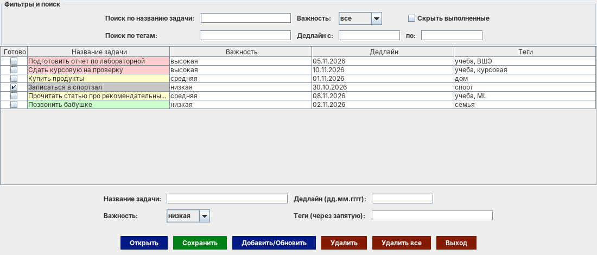

# To-Do List Manager

Десктопное приложение для списка задач на Java Swing: важность с цветовой подсветкой, дедлайны, теги, фильтры и сохранение в файл.


Учебный проект по объектно-ориентированному программированию.



## Возможности

- добавление, редактирование и удаление задач
- у задачи есть название, важность (низкая / средняя / высокая), дедлайн и теги
- строки подсвечиваются цветом по важности, выполненные задачи становятся серыми
- поиск по названию и тегам, фильтр по важности и диапазону дедлайнов, скрытие выполненных
- сортировка по любому столбцу
- сохранение в текстовый файл и загрузка из него
- предупреждение о несохраненных изменениях при выходе или открытии другого файла

## Запуск

Нужна Java 11+.

```bash
javac -encoding UTF-8 *.java
java ListApp
```

Чтобы посмотреть приложение с данными, нажмите «Открыть» и выберите `example_tasks.txt`.

## Структура

- `Task.java` - модель задачи
- `ListApp.java` - интерфейс: таблица, фильтры, форма ввода, работа с файлами

Формат файла - одна задача на строку: `выполнена;название;важность;дедлайн;теги`, например

```
false;Сдать курсовую на проверку;высокая;10.11.2026;учеба,курсовая
```
